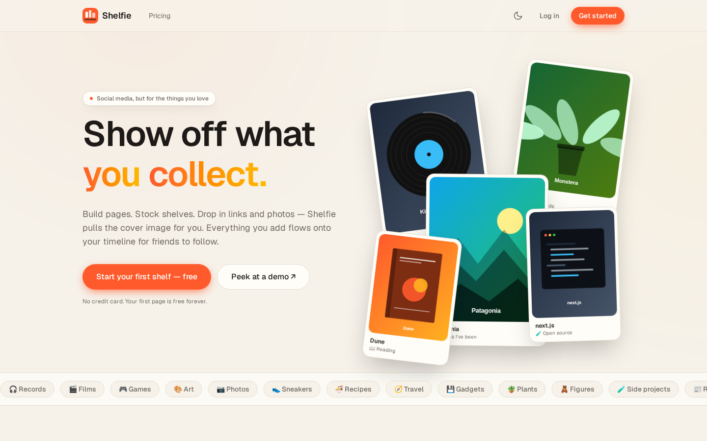

# Shelfie 🗄️

**Show off what you collect.** Shelfie is a social showcase app: build *pages*, stock them with *shelves*
(each shelf holds one category), and drop in links or photos. Everything you add also lands on your public
**timeline**, and in the home feed of people who follow you.

Built with **Next.js 16 (App Router) · TypeScript · Tailwind CSS 4 · Prisma + SQLite · GSAP**.



## Features

- **Pages → Shelves → Items.** A person has pages; a page has up to **5 shelves** (enforced on the server *and* in the UI);
  each shelf has a name and one category; shelves hold items.
- **Add a link or a photo**, with a title and optional description.
  - Links: the page's `og:image` / `twitter:image` / `image_src` / first large `` / favicon becomes the thumbnail
    (cached locally so cards never break); title & description are pre-filled from the page when left blank.
    A live preview appears in the dialog as you paste.
  - Photos: JPG/PNG/WebP/GIF up to 8 MB, validated by content (magic bytes), re-encoded (EXIF/GPS stripped) and stored under `UPLOAD_DIR`.
- **Timeline** on every profile (chronological, grouped by day, infinite "load older") + a **home feed** (Following / Everyone).
- **Page switcher** at the top of a profile; the URL keeps the selected page (`/u/name?page=…`).
- **Paywall:** the first page is free; extra pages need **Shelfie Plus**. Stripe Checkout + webhook when configured,
  otherwise a clearly-labelled **demo mode** upgrade.
- **Public profiles** at `/u/[username]`, follow/unfollow, edit profile, edit/delete items, shelves and pages,
  drag-to-reorder items (plus ← / → buttons for touch & keyboard).
- Dark mode, responsive/mobile-first, empty states, loading skeletons, toasts, error & 404 pages, accessible dialogs.
- **GSAP animation** (all respecting `prefers-reduced-motion`): hero text/collage with mouse parallax, page transitions,
  ScrollTrigger reveals for shelves/items/timeline (scrubbed timeline line), **Flip** for reorder/add/remove,
  3D hover **tilt** on cards, elastic page-switcher indicator, a satisfying add-item pop + confetti burst, animated modals & toasts.

## Quick start

Requires Node 20+ (tested on Node 24).

```bash
npm install                 # also runs `prisma generate`
cp .env.example .env        # defaults work out of the box
npm run db:setup            # prisma migrate deploy + seed demo data
npm run dev                 # http://localhost:3000
```

Production-style:

```bash
npm run build
npm run start               # http://localhost:3000
```

### Demo accounts (created by the seed)

| Email | Password | Notes |
|---|---|---|
| `demo@shelfie.app` | `demo1234` | free plan, 1 page, 4 shelves — try the paywall |
| `maya@shelfie.app` | `maya1234` | Plus, 2 pages (page switcher) |
| `kenji@shelfie.app` | `kenji1234` | free plan |

Seed images are generated SVG placeholders in `public/seed/`, so the demo looks right fully offline.
Re-running `npm run db:seed` resets just those three users.

## Environment variables

See [`.env.example`](.env.example). Nothing secret is hard-coded.

| Variable | Default | Purpose |
|---|---|---|
| `DATABASE_URL` | `file:./dev.db` | Prisma connection string (SQLite file, relative to `prisma/`). |
| `APP_URL` | `http://localhost:3000` | Public base URL: Stripe redirect URLs, metadata, and the `Secure` cookie flag when it starts with `https://`. |
| `UPLOAD_DIR` | `./uploads` | Where photos & cached thumbnails are stored (served via `/api/uploads/<name>`). |
| `MAX_UPLOAD_MB` | `8` | Upload size limit. |
| `STRIPE_SECRET_KEY` | _empty_ | Stripe secret key. |
| `STRIPE_PRICE_ID` | _empty_ | Price ID of the recurring Plus price. |
| `STRIPE_WEBHOOK_SECRET` | _empty_ | Signing secret for the webhook endpoint. |
| `PLUS_PRICE_LABEL` | `$4 / month` | Display text only. |
| `SSRF_ALLOW_CIDRS` | _empty_ | Escape hatch for networks whose DNS maps public sites into a reserved range (e.g. some sandboxes use `198.18.0.0/15`). Leave empty in production. |

### Subscriptions: Stripe vs demo mode

- **Stripe configured** (`STRIPE_SECRET_KEY` + `STRIPE_PRICE_ID`): "Upgrade" creates a Stripe Checkout Session
  (`POST /api/billing/checkout`). Point a Stripe webhook at **`/api/billing/webhook`** and subscribe to
  `checkout.session.completed`, `customer.subscription.created|updated|deleted`; set `STRIPE_WEBHOOK_SECRET`.
  Signatures are verified; access follows the subscription status. Local testing: `stripe listen --forward-to localhost:3000/api/billing/webhook`.
- **Not configured → demo mode:** the upgrade button is labelled *Demo mode* and just flags the account as subscribed
  (`POST /api/billing/demo-upgrade`, which is **disabled automatically once Stripe is configured**).

## Scripts

| Script | What it does |
|---|---|
| `npm run dev` / `build` / `start` | Next.js |
| `npm run lint` · `npm run typecheck` | ESLint · `tsc --noEmit` |
| `npm test` | Vitest (shelf limit, paywall, SSRF guard, OG parsing, authorization, uploads, Stripe webhook logic) on a throwaway SQLite file |
| `npm run e2e` | HTTP end-to-end script against a running server (`BASE_URL`, default `localhost:3000`) |
| `npm run screenshots` | Playwright (headless Chromium) UI flow + screenshots into `screenshots/` |
| `npm run db:migrate` · `db:seed` · `db:setup` | Prisma migrate deploy · seed · both |

For the Playwright scripts: `npx playwright install chromium` once.

## Architecture

```
prisma/schema.prisma        User, Session, Page, Shelf, Item, Follow (enums are validated strings → Postgres-portable)
src/lib/limits.ts           business rules: 5 shelves/page, 1 free page (pure functions)
src/lib/services/*          domain logic + authorization (accounts, pages, shelves, items, feed, billing, profile)
src/lib/net/ip-guard.ts     SSRF: blocklist of private/loopback/link-local/reserved ranges (v4 + v6 + mapped)
src/lib/net/safe-fetch.ts   SSRF-safe fetch: http(s) only, DNS-resolved + pinned IP, redirects re-validated, timeout, byte cap
src/lib/net/og.ts           og:image / twitter:image / first-large-img / favicon parsing (cheerio)
src/lib/uploads.ts          magic-byte validation, sharp re-encode, random filenames
src/app/api/**              JSON route handlers (zod validation, origin check, rate limits)
src/components/**           UI (profile/, feed/, landing/, ui/, motion/)
```

Security notes: passwords hashed with bcrypt; sessions are random 256-bit tokens stored **hashed** in the DB, sent as
`HttpOnly; SameSite=Lax` cookies (`Secure` on https); mutating requests require a same-origin `Origin`; all input is
validated with zod; every mutation checks ownership server-side; uploads can't be served with a content type other than the
re-encoded image and carry `CSP: sandbox`; auth/preview/create endpoints are rate limited (in-memory — swap for Redis when running multiple instances).

## Deploying (e.g. Vercel + Postgres + Stripe)

1. Switch `provider` to `"postgresql"` in `prisma/schema.prisma`, set `DATABASE_URL` to your Postgres URL, run `prisma migrate dev` once to generate Postgres migrations, then `prisma migrate deploy` on deploy.
2. **Uploads:** local disk doesn't persist on serverless. Move `saveUploadedImage` / `/api/uploads` to S3/R2/Vercel Blob (all file I/O is isolated in `src/lib/uploads.ts` and the uploads route).
3. Set `APP_URL` (https), the three `STRIPE_*` vars, and create the webhook endpoint in the Stripe dashboard.
4. Replace the in-memory rate limiter / mutex (`src/lib/rate-limit.ts`, `src/lib/mutex.ts`) with Redis or DB-level locking for multi-instance setups.
